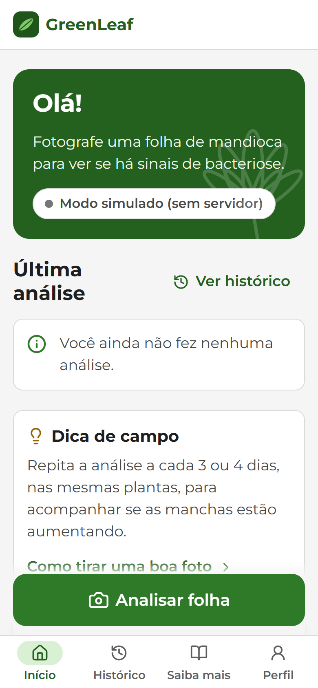
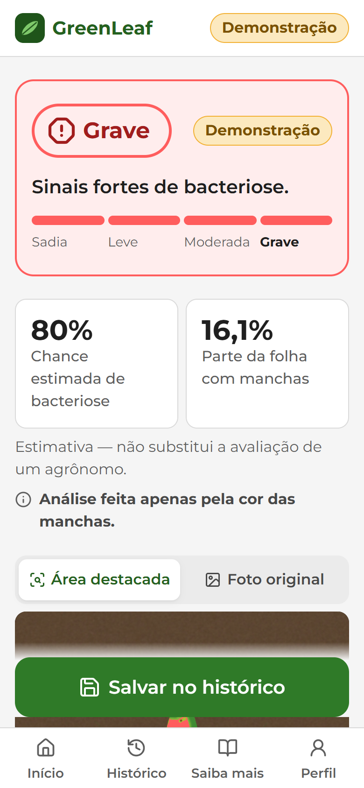
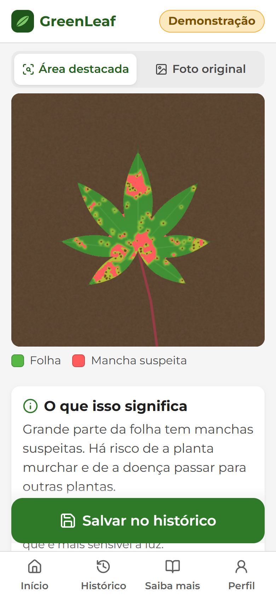
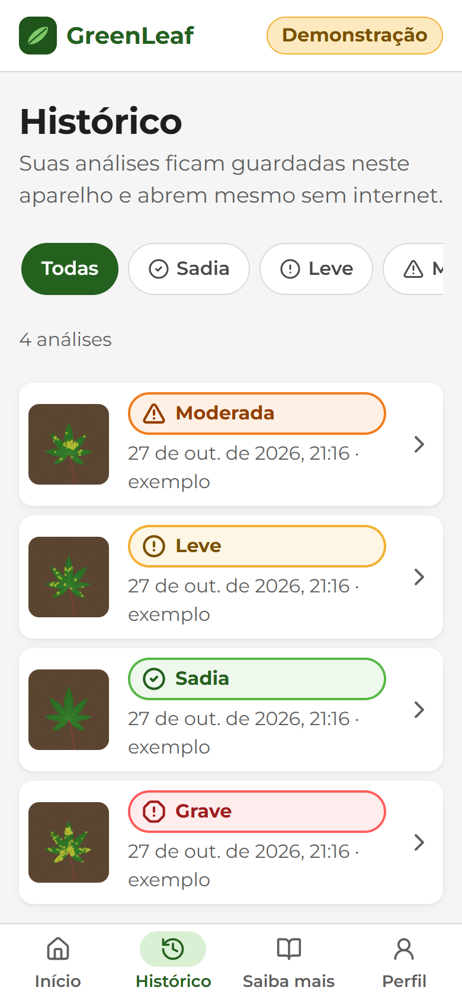

# GreenLeaf — App

Aplicativo web instalável (PWA) que analisa fotos de folhas de mandioca e indica, em linguagem simples, o risco de
bacteriose (*Xanthomonas phaseoli* pv. *manihotis*), destacando a área suspeita. Projeto Integrador V do curso de
Desenvolvimento de Software Multiplataforma da FATEC Registro.

**App:** https://greenleaf-mobile.vercel.app
**Repositório da IA:** [https://greenleaf-mobile.vercel.app](https://github.com/Yajoojj/Axios_Cassava_IA)

> O resultado é uma estimativa e não substitui a avaliação de um agrônomo nem um exame de laboratório.

## Telas

| Início | Diagnóstico | Área destacada | Histórico |
|---|---|---|---|
|  |  |  |  |

## Funcionalidades

- Foto pela câmera ou pela galeria, reduzida e sem metadados antes do envio
- Resultado com nível de risco, área destacada e orientações
- Histórico no aparelho ou na nuvem, com fila offline
- Contas com Supabase, exportação de dados e exclusão de conta
- Modo demonstração, que funciona sem internet
- Português e inglês

## Tecnologias

React 18, TypeScript, Vite, vite-plugin-pwa, Zod, Supabase (Auth, Postgres, Storage e Edge Functions), Vitest e
Testing Library.

## Como executar

Requisito: Node.js 22 ou superior.

```bash
npm install
```

```bash
npm run dev
```

O app abre em http://localhost:5173. Sem variáveis de ambiente, ele usa um serviço simulado e guarda os dados só no
navegador.

Para usar a API e o Supabase, copie o arquivo de exemplo e preencha os valores:

```bash
cp .env.example .env.local
```

| Variável | Descrição |
|---|---|
| `VITE_API_URL` | URL da [API de análise](https://github.com/Yajoojj/Axios_Cassava_IA) |
| `VITE_SUPABASE_URL` | URL do projeto Supabase |
| `VITE_SUPABASE_ANON_KEY` | Chave pública (anon) do projeto Supabase |
| `VITE_FEATURE_GEOLOCATION` | Ativa a localização (`true` ou `false`) |
| `VITE_FEATURE_HEATMAP` | Ativa o mapa de calor (`true` ou `false`) |

Nunca coloque a chave `service role` nessas variáveis: elas são enviadas ao navegador.

## Scripts

| Comando | Descrição |
|---|---|
| `npm run dev` | Servidor de desenvolvimento |
| `npm run build` | Build de produção |
| `npm run preview` | Serve o build em http://localhost:4173 |
| `npm test` | Testes |
| `npm run typecheck` | Verificação de tipos |

## Supabase

As migrações ficam em `supabase/migrations` e as funções em `supabase/functions`. Para configurar um projeto novo:

```bash
npx supabase link --project-ref <ref-do-projeto>
```

```bash
npx supabase db push
```

```bash
npx supabase functions deploy delete-account
```

```bash
npx supabase functions deploy export-data
```

## Estrutura

```text
src/
  app/        provedores, layout e rotas
  config/     variáveis de ambiente e criação dos serviços
  data/       repositórios do histórico (IndexedDB e Supabase)
  domain/     tipos, regras e contratos
  i18n/       traduções
  pages/      telas
  services/   API, autenticação, imagem e localização
  ui/         componentes visuais
supabase/     migrações, funções e testes de RLS
```

## Documentação

- [Decisões técnicas](docs/decisoes.md)
- [Diagrama do banco](docs/diagrama-banco.md)
- [Segurança](docs/seguranca-owasp.md)
- [Design system](docs/design-system.md)

## Equipe

- Carlos Eduardo Campos Takeshita
- Filipe de Oliveira Lima 
- Yago Uran Kurashiki Rios
