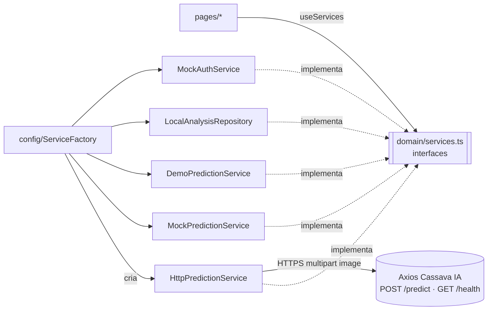

# GreenLeaf — front-end (PWA)

Web app **mobile-first e instalável** que fotografa uma folha de mandioca, envia ao módulo de IA
**Axios Cassava IA** e mostra, em linguagem simples, se há sinais de **bacteriose**
(*Xanthomonas phaseoli* pv. *manihotis*), com a área suspeita destacada.

Projeto Integrador V — DSM, **FATEC Registro** (Vale do Ribeira, SP).
Equipe: Carlos Eduardo Campos Takeshita, Filipe de Oliveira Lima, Marcelo Augusto Pedroso Martins e Yago Uran Kurashiki Rios.

> O resultado é uma **estimativa** e não substitui a avaliação de um agrônomo nem um exame de laboratório.

## Objetivo

Atender aos requisitos levantados com o produtor (artigo, Tabela 3) e às metas O3/O4 (Tabela 1):

| Requisito | Como o front atende |
|---|---|
| RF1 câmera ou galeria | `getUserMedia` com moldura-guia; reserva `<input capture="environment">`; galeria |
| RF2 classe, severidade e texto | Estados **Sadia / Leve / Moderada / Grave** com cor + ícone + texto, "O que isso significa" e "O que fazer agora" |
| RF3 área suspeita destacada | Alternância **Área destacada ↔ Foto original** com legenda |
| RNF1 app leve | Foto girada, reduzida para 1280 px e recomprimida no aparelho antes do envio (sem EXIF) |
| RNF2 resposta ≤ 5 s | Etapas reais (enviando → analisando → preparando), aviso após 5 s e aviso de "servidor acordando" |
| O4 SUS ≥ 70 | Clareza acima de efeitos, alvos ≥ 48 px, contraste ≥ 4,5:1 testado, ações na metade de baixo |

## Prints (capturas reais do app)

Gerados com `node scripts/screenshots.mjs` sobre o build de produção, no **modo demonstração**
(as folhas dos exemplos são ilustrações geradas por código — ver [docs/decisoes.md](docs/decisoes.md), D-04).

| Boas-vindas | Início | Captura (demonstração) | Processando |
|---|---|---|---|
|  |  |  |  |

| Diagnóstico grave | Área destacada | O que fazer | Folha sadia |
|---|---|---|---|
|  |  |  |  |

| Histórico | Saiba mais | Perfil | Suporte |
|---|---|---|---|
|  |  |  |  |

Desktop (mesmo app, responsivo):


## Como rodar

Requisitos: Node 22+.

```bash
npm install
```

```bash
npm run dev
```

Abre em `http://localhost:5173`. Sem `VITE_API_URL`, o app usa o **serviço simulado** (selo "Resultado simulado").

Para usar a API real, crie `.env.local` a partir de `.env.example`:

```bash
cp .env.example .env.local
```

e defina `VITE_API_URL=https://<sua-api>`. Em desenvolvimento, `http://localhost:8000` também é aceito.
No servidor, inclua a origem do app em `CORS_ORIGINS` (ex.: `http://localhost:5173,https://greenleaf.exemplo.app`).

Outros comandos:

| Comando | O que faz |
|---|---|
| `npm test` | Testes (Vitest + Testing Library + axe-core) |
| `npm run typecheck` | Verificação de tipos |
| `npm run build` | Build de produção com service worker e CSP |
| `npm run preview` | Serve o build em `http://localhost:4173` (teste do PWA/offline) |
| `node scripts/screenshots.mjs` | Regera os prints de `docs/prints` (com o `preview` rodando) |
| `API_URL=https://... node scripts/record-demo.mjs` | Grava respostas reais da API para o modo demonstração |

**Recursos futuros** (atrás de flag, desligados por padrão): `VITE_FEATURE_GEOLOCATION=true` mostra o
consentimento de localização e `VITE_FEATURE_HEATMAP=true` mostra o mapa de calor com dados fictícios e etiqueta "Em breve".

### Modo demonstração (apresentação e feira)

Perfil → **Modo demonstração**. Quatro folhas de exemplo (sadia, leve, moderada, grave) com respostas gravadas.
Tudo fica no cache do service worker: depois de abrir o app uma vez, funciona em **modo avião**.
O selo "Demonstração" aparece no topo de todas as telas. Se uma análise real falhar por falta de internet, a tela de erro oferece "Usar modo demonstração".

### Instalar no celular

Abra o endereço publicado no Chrome (Android) ou Safari (iPhone) → "Instalar app" / "Adicionar à Tela de Início".
Há uma tela "Instalar no celular" no app com o passo a passo e, quando o navegador permite, botão de instalação direta.

## Arquitetura

```
src/
  domain/    entidades, regras e contratos — sem React, sem rede
             types.ts, schemas.ts (zod), Diagnosis.ts (mapPrediction), AnalysisBuilder.ts, errors.ts, services.ts (interfaces)
  services/  implementações: HttpPredictionService, MockPredictionService, DemoPredictionService,
             MockAuthService, BrowserLocationService, MockFeedbackService, BrowserImagePreparer, colorAnalysis
  data/      LocalAnalysisRepository (IndexedDB)
  config/    env.ts (VITE_API_URL validada + feature flags), ServiceFactory.ts (único lugar que instancia classes concretas)
  app/       provedores (configurações, serviços, sessão, conta, avisos), layout e rotas
  ui/        design system: tokens.ts/tokens.css, styles.css, componentes
  pages/     telas (só conhecem as interfaces, via useServices())
  i18n/      pt-BR (padrão) e en
docs/        decisoes.md, seguranca-owasp.md, design-system.md, prints/
scripts/     geração dos assets de demonstração, gravação de respostas reais, prints
```



- **POO**: a camada de domínio e os serviços são classes TypeScript que implementam interfaces
  (`PredictionService`, `AnalysisRepository`, `AuthService`, `LocationService`, `FeedbackService`, `ImagePreparer`).
  Os componentes de UI são funcionais.
- **Nenhuma tela importa implementação concreta** — verificado por `src/test/architecture.test.ts`.
- **`mapPrediction`** (`src/domain/Diagnosis.ts`) é uma função pura com testes: `Saudavel` → Sadia ignorando a severidade;
  `Infectado` → Leve/Moderada/Grave; probabilidade em % arredondada; `model_probability === null` → aviso "Análise feita apenas pela cor das manchas".

### Contrato da API (verificado no código do Axios Cassava IA)

`POST {VITE_API_URL}/predict` — `multipart/form-data`, campo `image`, JPEG/PNG, máx. 8 MB →
`{ probability, model_probability|null, hsv_probability, class: "Infectado"|"Saudavel", ratio, severity: "Leve"|"Moderada"|"Grave", processing_time_ms, overlay }`.
Erros `400`, `413`, `500` com `{ "detail": "..." }`. `GET /health` → `{ status, version, environment, model_loaded, supabase_logging }`.
Toda resposta passa por validação de schema (zod) antes de chegar à tela.

## Mocks a substituir (prompt de back-end)

| Interface | Implementação atual | Substituir por | Onde trocar |
|---|---|---|---|
| `PredictionService` | `MockPredictionService` (análise de cor local, sempre marcada "simulado") | `HttpPredictionService` — **já pronto**, basta definir `VITE_API_URL` | automático |
| `AuthService` | `MockAuthService` (contas só neste navegador, senha com PBKDF2) | `SupabaseAuthService` (Supabase Auth) | `config/ServiceFactory.ts` |
| `AnalysisRepository` | `LocalAnalysisRepository` (IndexedDB, offline) | manter como cache + `CloudAnalysisRepository` (Supabase, tabela `analise`) | `config/ServiceFactory.ts` |
| `FeedbackService` | `MockFeedbackService` (guarda no aparelho) | endpoint/tabela de suporte | `config/ServiceFactory.ts` |
| `LocationService` | `BrowserLocationService` (flag) | igual, enviando lat/long arredondadas para a tabela `localizacao` | `config/ServiceFactory.ts` |
| Mapa de calor | dados fictícios em `pages/HeatmapPage.tsx` | consulta agregada por região | `pages/HeatmapPage.tsx` |

As telas não mudam: elas só falam com as interfaces de `src/domain/services.ts`.

## Documentos

- [docs/decisoes.md](docs/decisoes.md) — diário de bordo técnico: decisões e suposições.
- [docs/seguranca-owasp.md](docs/seguranca-owasp.md) — checklist de segurança (OWASP) com o que foi aplicado e onde.
- [docs/design-system.md](docs/design-system.md) — tokens e componentes com nomes prontos para o Figma.
