# GreenLeaf — front-end (PWA)

Web app **mobile-first e instalável** que fotografa uma folha de mandioca, envia ao módulo de IA
**GreenLeaf IA v2** ([Axios_Cassava_IA](https://github.com/Yajoojj/Axios_Cassava_IA), na Render) e mostra, em linguagem simples, se há sinais de **bacteriose**
(*Xanthomonas phaseoli* pv. *manihotis*), com a área suspeita destacada.

Projeto Integrador V — DSM, **FATEC Registro** (Vale do Ribeira, SP).
Equipe: Carlos Eduardo Campos Takeshita, Filipe de Oliveira Lima, Marcelo Augusto Pedroso Martins e Yago Uran Kurashiki Rios.

> O resultado é uma **estimativa** e não substitui a avaliação de um agrônomo nem um exame de laboratório.

## Objetivo

Atender aos requisitos levantados com o produtor (artigo, Tabela 3) e às metas O3/O4 (Tabela 1):

| Requisito | Como o front atende |
|---|---|
| RF1 câmera ou galeria | `getUserMedia` com moldura-guia; reserva `<input capture="environment">`; galeria |
| RF2 classe, severidade e texto | Estados **Sadia / Leve / Moderada / Grave** com cor + ícone + texto, "O que isso significa" e "O que fazer agora" |
| RF3 área suspeita destacada | Alternância **Área destacada ↔ Foto original** com legenda |
| RNF1 app leve | Foto girada, reduzida para 1280 px e recomprimida no aparelho antes do envio (sem EXIF) |
| RNF2 resposta ≤ 5 s | Etapas reais (enviando → analisando → preparando), aviso após 5 s e aviso de "servidor acordando" |
| O4 SUS ≥ 70 | Clareza acima de efeitos, alvos ≥ 48 px, contraste ≥ 4,5:1 testado, ações na metade de baixo |

## Prints (capturas reais do app)

Gerados com `node scripts/screenshots.mjs` sobre o build de produção, no **modo demonstração**
(as folhas dos exemplos são ilustrações geradas por código — ver [docs/decisoes.md](docs/decisoes.md), D-04).

| Boas-vindas | Início | Captura (demonstração) | Processando |
|---|---|---|---|
| 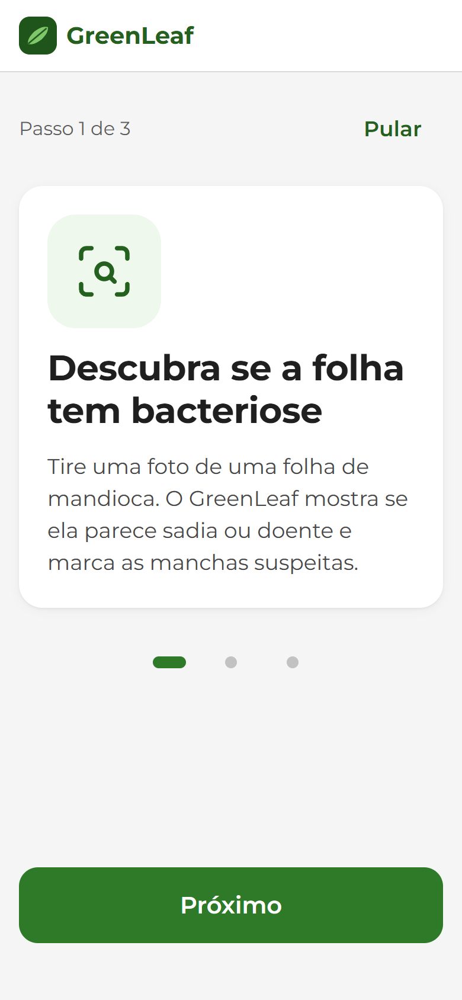 | 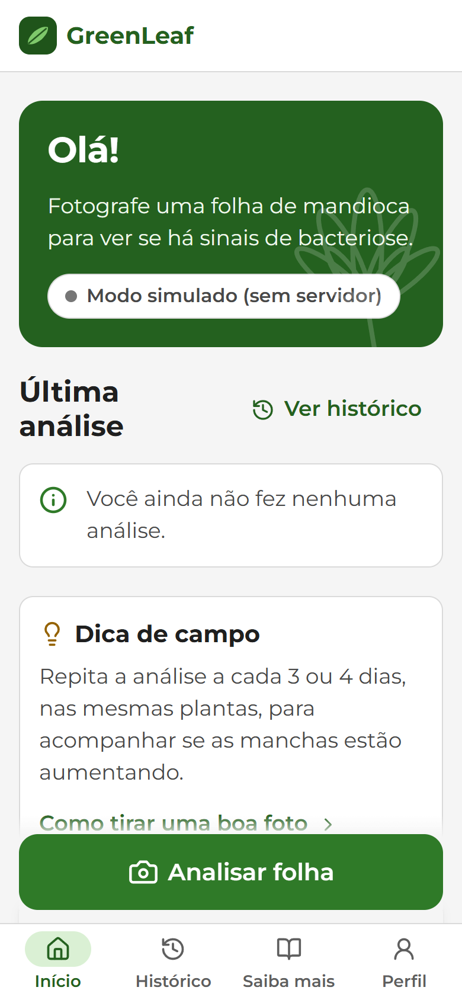 | 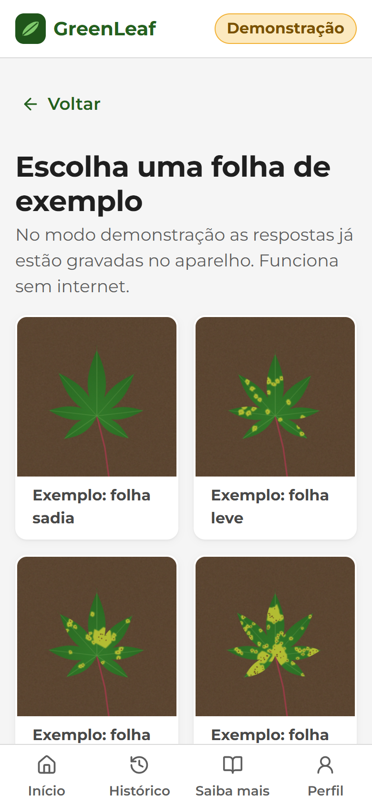 | 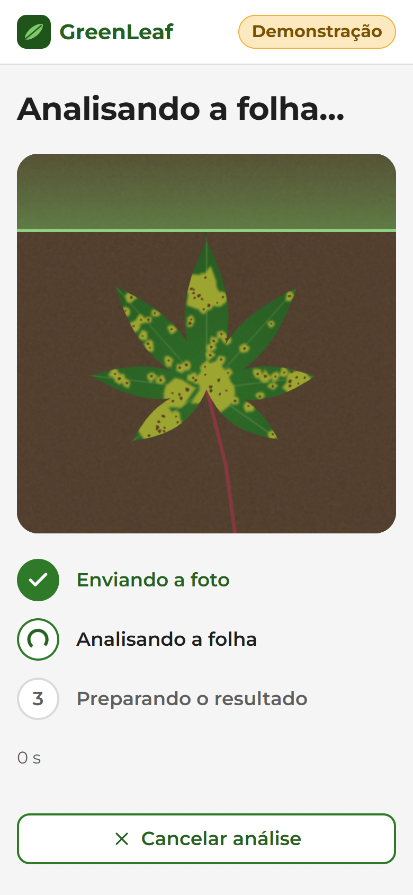 |

| Diagnóstico grave | Área destacada | O que fazer | Folha sadia |
|---|---|---|---|
| 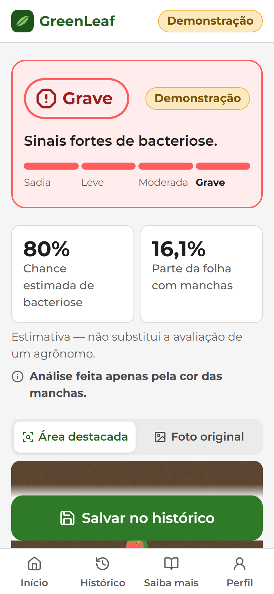 | 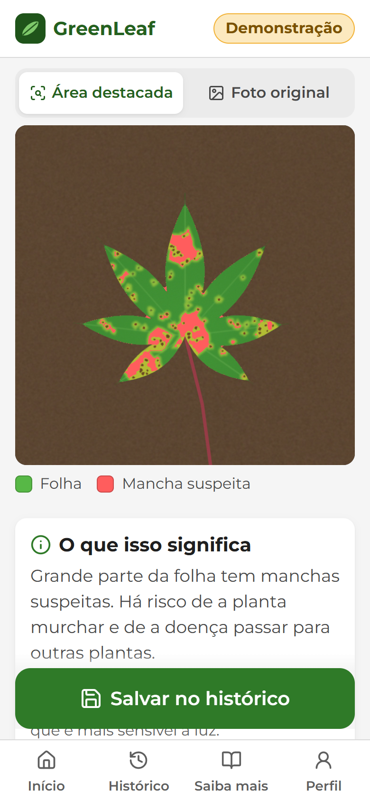 | 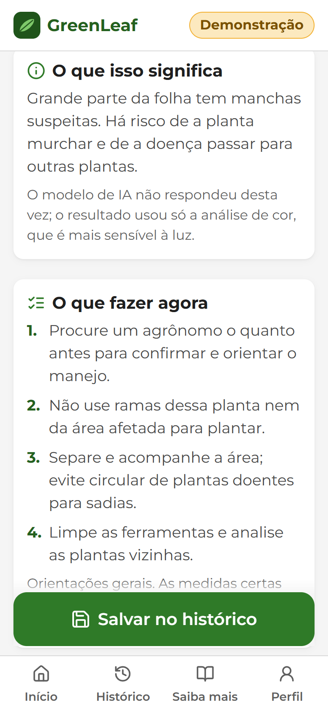 | 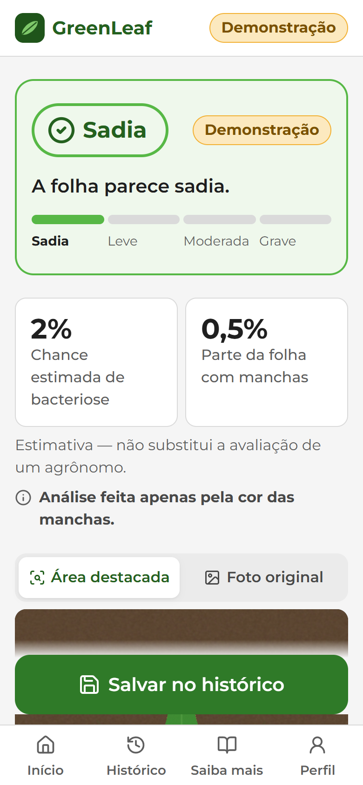 |

| Histórico | Saiba mais | Perfil | Suporte |
|---|---|---|---|
| 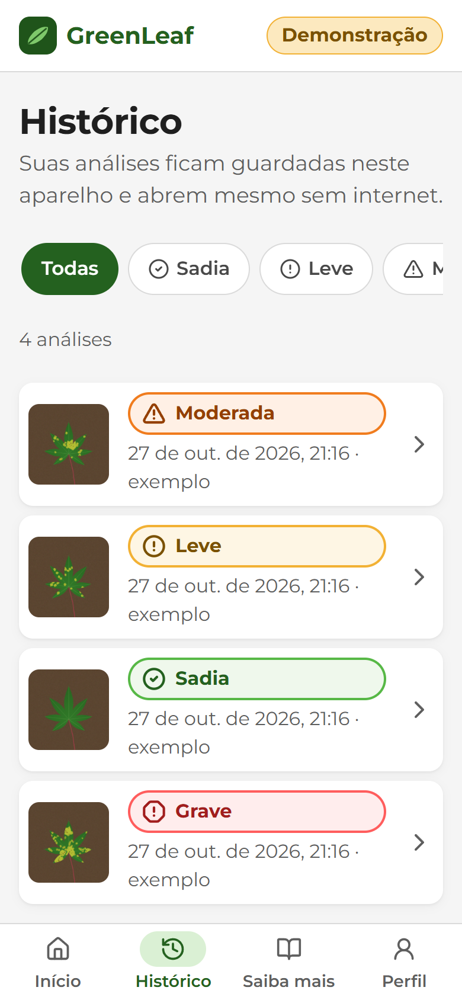 | 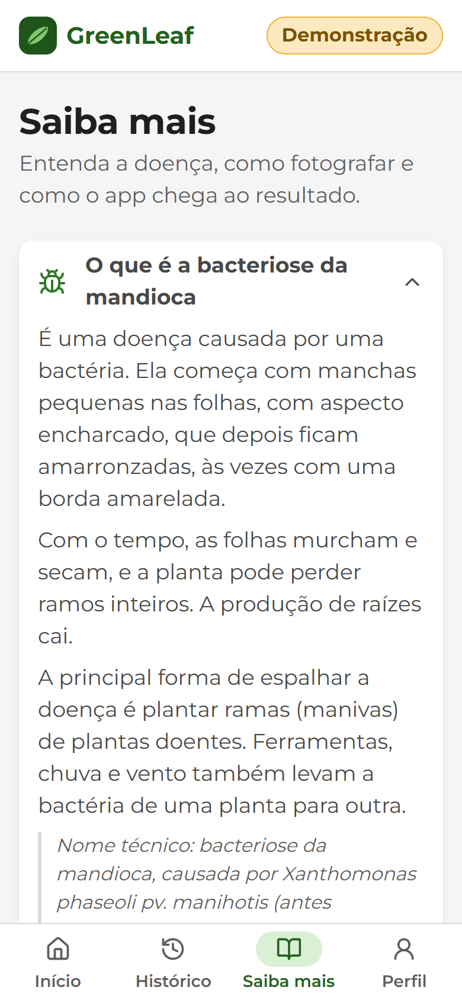 | 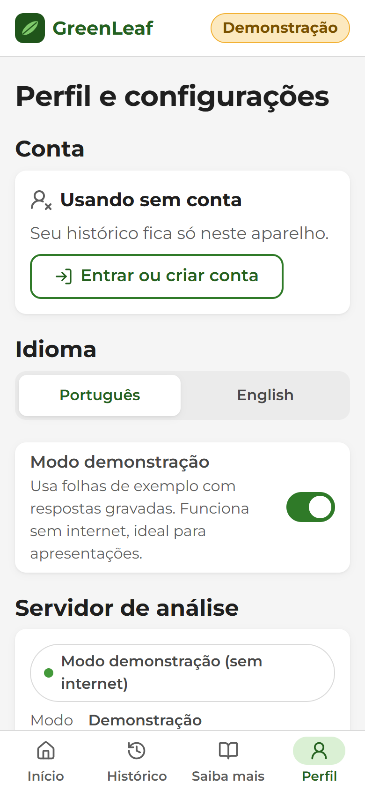 | 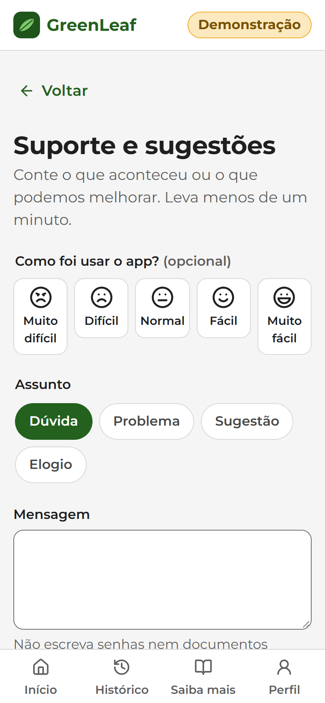 |

Desktop (mesmo app, responsivo):

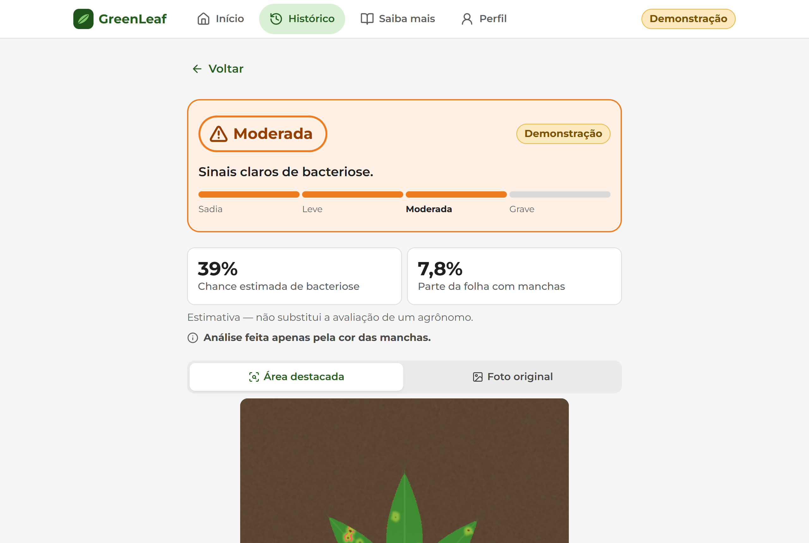

## Como rodar

Requisitos: Node 22+.

```bash
npm install
```

```bash
npm run dev
```

Abre em `http://localhost:5173`. Sem variáveis, o app usa o **serviço simulado** (selo "Resultado simulado") e
contas/histórico **só no aparelho** — funciona exatamente como antes do back-end.

Para usar a IA e o back-end reais, crie `.env.local` a partir de `.env.example`:

```bash
cp .env.example .env.local
```

### Variáveis de ambiente (públicas — vão para o navegador)

| Variável | Para quê | Sem ela |
|---|---|---|
| `VITE_API_URL` | IA v2 na Render (`https://greenleaf-ia.onrender.com`) | `MockPredictionService` (análise de cor local, "simulado") |
| `VITE_SUPABASE_URL` | Projeto Supabase **do app** (`https://mfngcmjgisfgttsgqyfl.supabase.co`) | contas e histórico só no aparelho (mocks) |
| `VITE_SUPABASE_ANON_KEY` | Chave **anônima/publicável** do mesmo projeto | idem |
| `VITE_FEATURE_GEOLOCATION`, `VITE_FEATURE_HEATMAP` | Liga localização e mapa de calor | escondidos |

A chave **service role** (ou `sb_secret_…`) nunca vai para o app: `checkSupabase` em `src/config/env.ts` a recusa se alguém
a colocar por engano. Em desenvolvimento, `http://localhost:8000` é aceito para a IA; no servidor da IA, a origem do app
precisa estar em `CORS_ORIGINS`.

### Publicar (Vercel)

No projeto da Vercel **do Greenleaf-Mobile** (não o do repositório da IA, que publica o front antigo em `frontend/`):
Settings → Environment Variables → `VITE_API_URL`, `VITE_SUPABASE_URL`, `VITE_SUPABASE_ANON_KEY` (Production e Preview) → Redeploy.
A CSP de `vercel.json` e `public/_headers` já libera essas duas origens; se trocar de projeto ou serviço, troque lá também.

### No ar

| Parte | Onde | Endereço |
|---|---|---|
| App (PWA) | Vercel, projeto `greenleaf-mobile` | https://greenleaf-mobile.vercel.app |
| IA v2 | Render, serviço `greenleaf-ia` (plano gratuito) | https://greenleaf-ia.onrender.com (`/health`) |
| Back-end | Supabase, projeto `greenleaf-app` (São Paulo) | `https://mfngcmjgisfgttsgqyfl.supabase.co` |

**IA acordada:** no plano gratuito a Render desliga o serviço depois de ~15 min sem uso, e a primeira análise depois disso
demora até 1 minuto. Uma tarefa no [cron-job.org](https://cron-job.org) ("GreenLeaf IA – manter acordada") chama
`GET /health` a cada 10 minutos para evitar isso; as 750 h grátis por mês da Render cobrem um serviço ligado o tempo todo.
Se a tarefa parar, o app continua funcionando: ao abrir, ele mesmo chama `/health` e mostra "Servidor acordando" (D-34).

Outros comandos:

| Comando | O que faz |
|---|---|
| `npm test` | Testes (Vitest + Testing Library + axe-core) |
| `npm run typecheck` | Verificação de tipos |
| `npm run build` | Build de produção com service worker e CSP |
| `npm run preview` | Serve o build em `http://localhost:4173` (teste do PWA/offline) |
| `node scripts/screenshots.mjs` | Regera os prints de `docs/prints` (com o `preview` rodando) |
| `API_URL=https://... node scripts/record-demo.mjs` | Grava respostas reais da IA v2 para o modo demonstração |
| `node scripts/supabase-e2e.mjs` | Teste ponta a ponta da RLS, do Storage e das edge functions no Supabase real |

**Recursos atrás de flag** (desligados por padrão): `VITE_FEATURE_GEOLOCATION=true` mostra o consentimento de localização e
`VITE_FEATURE_HEATMAP=true` mostra o mapa de calor — com o Supabase, só células agregadas (≥ 5 análises em ~5 km);
sem ele, dados fictícios com a etiqueta "Em breve".

### Modo demonstração (apresentação e feira)

Perfil → **Modo demonstração**. Cinco folhas de exemplo com **respostas reais da IA v2** gravadas
(`model_version`, 5 classes e overlay com o contorno amarelo), incluindo "Sem bacteriose — outra doença" (mosaico).
Cada exemplo é rotulado pelo resultado real da IA (D-29). Demonstrações nunca vão para a nuvem.
Tudo fica no cache do service worker: depois de abrir o app uma vez, funciona em **modo avião**.
O selo "Demonstração" aparece no topo de todas as telas. Se uma análise real falhar por falta de internet, a tela de erro oferece "Usar modo demonstração".

### Instalar no celular

Abra o endereço publicado no Chrome (Android) ou Safari (iPhone) → "Instalar app" / "Adicionar à Tela de Início".
Há uma tela "Instalar no celular" no app com o passo a passo e, quando o navegador permite, botão de instalação direta.

## Arquitetura

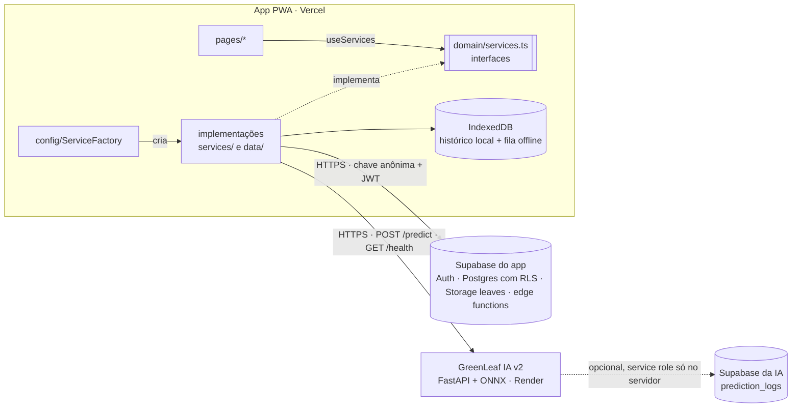

- **Dois Supabase separados.** O da IA (opcional) guarda só **logs técnicos** (`prediction_logs`), gravados pelo servidor com
  service role. O **do app** (`greenleaf-app`, São Paulo) guarda o **histórico do usuário**. O app nunca fala com o primeiro, e a
  tabela de logs não existe no segundo.
- **Nenhuma tela importa implementação concreta** — `src/test/architecture.test.ts` (inclui `Supabase*`, `Cloud*`, `SessionAware*`).

```
src/
  domain/    entidades, regras e contratos — sem React, sem rede
             types.ts, schemas.ts (zod), Diagnosis.ts (mapPrediction, riskLevel), AnalysisBuilder.ts, errors.ts, services.ts
  services/  HttpPredictionService, Mock/DemoPredictionService, Mock/SupabaseAuthService, Mock/SupabaseFeedbackService,
             Mock/SupabaseHeatmapService, BrowserLocationService, BrowserImagePreparer, supabaseClient.ts
  data/      LocalAnalysisRepository (IndexedDB), CloudAnalysisRepository (Supabase),
             SessionAwareAnalysisRepository (composição + fila), supabase.types.ts (gerado do banco)
  config/    env.ts (URLs validadas + flags), ServiceFactory.ts (único lugar que instancia classes concretas)
  app/       provedores, layout, rotas e HistorySyncPrompt (enviar o histórico local no primeiro login)
  ui/ pages/ i18n/
supabase/
  migrations/  esquema, RLS, Storage e mapa de calor (versionadas)
  functions/   delete-account, export-data (edge functions)
  tests/       rls.test.sql
```

### Histórico: aparelho, nuvem e fila

| Situação | Onde a análise fica |
|---|---|
| Sem conta | Só no aparelho (IndexedDB), como antes |
| Com conta e internet | Supabase: linha em `analyses` + fotos em `leaves/{user_id}/{id}/` + `locations` (se houver consentimento) |
| Com conta e sem internet | Fila local por usuário; sobe sozinha ao reconectar. O `id` gerado no app evita duplicata |
| Demonstração ou resultado simulado | Sempre só no aparelho |
| Primeiro login com histórico local | O app pergunta "Enviar minhas análises deste aparelho para a conta?" |

As telas recebem as fotos da nuvem como **URLs assinadas de 10 minutos** nos mesmos campos `imageDataUrl`/`overlayDataUrl`.

### Contrato da IA v2

`POST {VITE_API_URL}/predict` — `multipart/form-data`, campo `image`, JPEG/PNG, máx. 8 MB →
`{ probability, model_probability|null, hsv_probability, class, ratio, severity, processing_time_ms, overlay,
other_disease?, diagnosis?: {code,label,probability}, class_probabilities?: {CBB,CBSD,CGM,CMD,Healthy}, model_version? }`.
Erros `400`, `413` e `422` (foto pequena, escura ou estourada). `GET /health` também devolve `model_version`.
Toda resposta passa por zod antes de chegar à tela. Contrato completo: `INTEGRACAO.md` no repositório da IA.

**Risco em vez de porcentagem:** a tela principal mostra **Baixo** (< 0,26), **Médio** (0,26–0,60) ou **Alto** (> 0,60);
a porcentagem e a classe mais provável ficam em "Detalhes técnicos" (D-27).

## Back-end (Supabase)

Projeto `greenleaf-app` (`mfngcmjgisfgttsgqyfl`, `sa-east-1`). Tabelas finais: [docs/diagrama-banco.md](docs/diagrama-banco.md).

**Aplicar as migrações** (projeto novo ou outro ambiente), com a [CLI do Supabase](https://supabase.com/docs/guides/local-development):

```bash
npx supabase link --project-ref <ref-do-projeto>
```

```bash
npx supabase db push
```

**Publicar as edge functions:**

```bash
npx supabase functions deploy delete-account
```

```bash
npx supabase functions deploy export-data
```

Opcional: `npx supabase secrets set ALLOWED_ORIGINS=https://<dominio-do-app>` restringe o CORS das funções (sem ele, elas
aceitam qualquer origem, mas sempre exigem o JWT do usuário).

**Testar a RLS:** cole `supabase/tests/rls.test.sql` no SQL Editor (roda numa transação e termina com `ROLLBACK`) e rode
`scripts/supabase-e2e.mjs` com dois usuários de teste (passo a passo em [docs/seguranca-owasp.md](docs/seguranca-owasp.md)).

**Regerar os tipos** depois de mudar o esquema: `npx supabase gen types typescript --project-id <ref> > src/data/supabase.types.ts`.

**Configuração de Auth (painel → Authentication):** e-mail e senha, confirmação de e-mail ligada, senha mínima **8**,
*Site URL* e *Redirect URLs* com o domínio da Vercel, e SMTP próprio para produção (o SMTP padrão do Supabase só entrega
para membros da organização e tem limite baixo). Ver D-25.

## Documentos

- [docs/decisoes.md](docs/decisoes.md) — diário de bordo técnico: decisões e suposições (back-end a partir de D-20).
- [docs/diagrama-banco.md](docs/diagrama-banco.md) — diagrama de banco atualizado (tabelas finais do Supabase).
- [docs/seguranca-owasp.md](docs/seguranca-owasp.md) — checklist de segurança (OWASP) com o que foi aplicado e onde.
- [docs/design-system.md](docs/design-system.md) — tokens e componentes com nomes prontos para o Figma.
