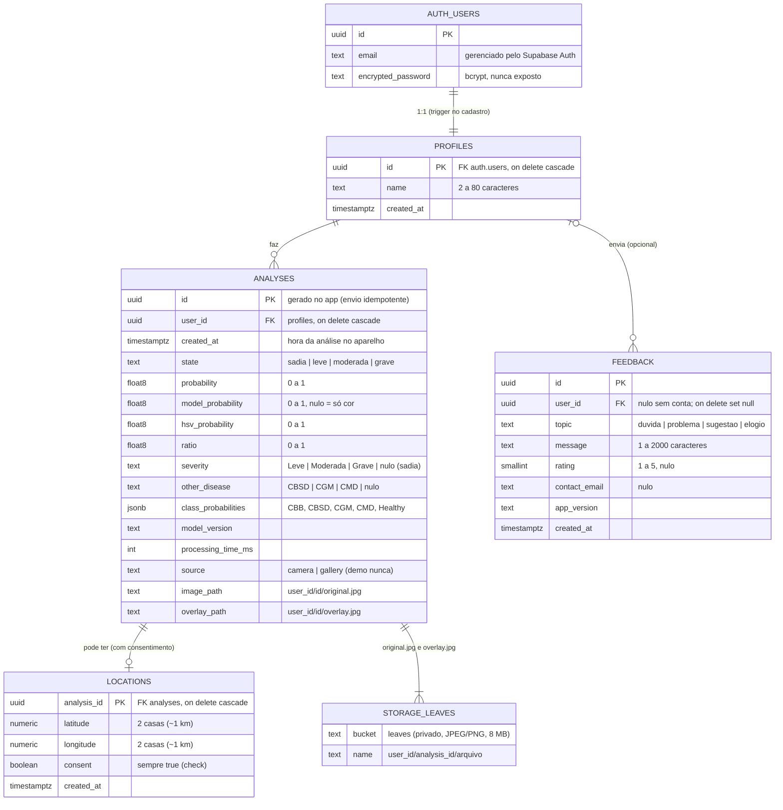

# Diagrama de banco — GreenLeaf (versão final, Supabase)

Atualiza o diagrama de banco dos Artefatos (`usuario`, `analise`, `localizacao`) com as tabelas que estão no projeto
`greenleaf-app` e com os campos da IA v2. Fonte: `supabase/migrations/`. Decisões em [decisoes.md](decisoes.md) (D-22 e D-23).

## O que mudou em relação aos Artefatos

| Artefatos | Final | Por quê |
|---|---|---|
| `usuario` com e-mail e senha | `auth.users` (Supabase Auth) + `profiles` (só o nome) | Senha e sessão ficam no serviço de autenticação; o app nunca vê hash de senha |
| `analise` com classe e probabilidade | `analyses` com `state`, `severity`, `other_disease`, `class_probabilities`, `model_version` | Campos da IA v2 (5 classes, "outra doença", versão do modelo no histórico) |
| imagem no registro | `image_path`/`overlay_path` + bucket privado `leaves` | Arquivo fora do banco; acesso só por URL assinada curta |
| `localizacao` | `locations` 1:1 com a análise, arredondada e com `consent` obrigatório | LGPD: só com consentimento e sem precisão de lavoura |
| — | `feedback` | Tela "Suporte e sugestões" |
| — | função `heatmap_cells()` | Mapa de calor só com dados agregados (≥ 5 análises por célula de ~5 km) |

Logs técnicos da IA (`prediction_logs`) **não** fazem parte deste banco: ficam no Supabase do servidor da IA.
